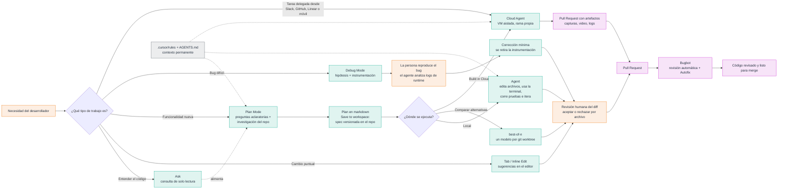
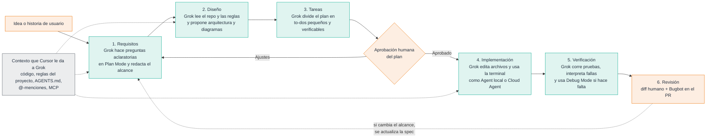

# Taller Spec-Driven Development

Micro-assignment del semillero: síntesis de dos videos sobre desarrollo asistido
por IA y exploración de un entorno de desarrollo agéntico (Cursor).

---

## Parte 1 · Spec-Driven Development (IBM Technology)

*Spec-Driven Development: AI Assisted Coding Explained*, Cedric Clyburn (feb. 2026) ·
https://youtu.be/mViFYTwWvcM

Generar código con IA es barato; lo difícil es que haga lo que se necesita. El
video contrasta el *vibe coding* (prompts repetidos hasta que el resultado "se ve
bien": rápido, pero inconsistente y sin planeación, diseño ni pruebas) con
**Spec-Driven Development**: escribir y acordar una especificación antes de generar
código. La spec funciona como un **contrato** (comportamiento, restricciones y
requisitos) y como fuente única de verdad para el equipo y para el agente.

- **Proceso:** especificar, diseñar, generar con IA e iterar contra la spec.
- **Encaje en el SDLC:** la spec guía la planeación y el diseño, es la entrada de la implementación, el criterio de las pruebas y la referencia del mantenimiento.
- **Frente a otros enfoques:** complementa a TDD y corrige el riesgo de desalineación del *code-first*.
- **Beneficios:** claridad, alineación del agente, menos retrabajo y escalabilidad.

Archivo editable: [`diagramas/01-mapa-spec-driven-development.drawio`](../diagramas/01-mapa-spec-driven-development.drawio)

---

## Parte 2 · La IA ha matado a Scrum (Javier Garzás)

*La IA ha matado a Scrum (esto es lo que viene ahora)*, Javier Garzás (mar. 2026) ·
https://www.youtube.com/watch?v=jrTrihcZZlc

Scrum nació en los años 90 para equipos solo de personas y su guía vigente (2020)
es anterior a ChatGPT. Con personas potenciadas por IA y equipos más pequeños, sus
piezas centrales dejan de encajar: el **sprint** de dos semanas se vuelve artificial
si la IA entrega en horas, sobran **ceremonias**, los **roles** clásicos de Product
Owner y Scrum Master pierden vigencia y las **historias de usuario** no alcanzan como
instrucción para una IA.

- **Lo que emerge:** un ciclo de dos carriles (rápido con vibe coding para aprender, robusto con specs y revisión para producción), una nueva QA enfocada en controlar lo que hace la IA, specs y SDD, y flujo continuo en lugar de iteraciones fijas.
- **Conexión con la Parte 1:** el carril robusto es Spec-Driven Development.
- **Lectura crítica:** Scrum.org responde que la IA abarata construir, no decidir qué construir ni comprobar que funciona; lo que muere es el Scrum de ceremonias.

Archivo editable: [`diagramas/02-mapa-la-ia-ha-matado-scrum.drawio`](../diagramas/02-mapa-la-ia-ha-matado-scrum.drawio).
Los recuadros con borde punteado son complementos de otras fuentes (Scrum Manager,
Scrum.org), no contenido del video.

---

## Parte 3 · Exploración y Evaluación del Entorno Agéntico Cursor

### Visión General de la Herramienta

Cursor es un entorno de desarrollo agéntico (*AI-native IDE*) construido como
fork de VS Code, por lo que conserva sus extensiones, atajos y configuración. Desde
Cursor 3 (abril de 2026) su interfaz gira alrededor de los agentes y no de los
archivos: un mismo espacio de trabajo muestra agentes que corren en el equipo
local o en la nube, lanzados desde el IDE, la web, el móvil, Slack, GitHub o Linear.
Permite elegir el modelo por tarea: los propios de Cursor (familia Composer) o
modelos de otros proveedores.

Cursor **no impone** Spec-Driven Development por defecto: no genera
`requirements.md`, `design.md` y `tasks.md` por defecto. En cambio, ofrece piezas
para cada etapa del ciclo (Plan Mode, reglas persistentes, agentes locales y en la
nube, Debug Mode, Bugbot) que el equipo combina según el tipo de trabajo. El
enfoque SDD se obtiene con convenciones: reglas en `.cursor/rules/`, un `AGENTS.md`
y una carpeta `specs/` versionada.

> **Nota metodológica.** No fue posible instalar Cursor en el equipo de trabajo, así
> que esta evaluación se basa en la documentación oficial, el changelog y el blog
> técnico de Cursor (ver Fuentes). Los flujos describen el comportamiento documentado
> de la herramienta, no una prueba práctica.

---

### Cuadro Resumen del Flujo de Trabajo en Cursor

El flujo depende del tipo de trabajo. Cada rama del diagrama es un escenario de uso
distinto; todos terminan en revisión humana y pull request.

Convenciones del diagrama: naranja = intervención humana, verde = trabajo del
agente, morado = revisión e integración, gris = contexto que el agente siempre lee.

---

### Escenarios de Uso

| # | Escenario | Función de Cursor | Qué hace el agente | Papel humano |
|---|---|---|---|---|
| 1 | Entender un código que no conozco | **Ask** | Responde preguntas sobre el repositorio sin modificar archivos | Pregunta y decide |
| 2 | Cambio pequeño y conocido | **Tab** e **Inline Edit** (`Ctrl+K`) | Autocompleta varias líneas o aplica una instrucción corta a la selección | Acepta o descarta cada sugerencia |
| 3 | Funcionalidad nueva (flujo SDD) | **Plan Mode** (`Shift+Tab`) + **Agent** | Hace preguntas aclaratorias, investiga el código, produce un plan revisable y luego lo implementa | Responde, edita y aprueba el plan antes de construir |
| 4 | Bug difícil de reproducir | **Debug Mode** | Formula hipótesis, instrumenta el código con logs, analiza la evidencia y propone una corrección acotada | Reproduce el bug dos veces: para capturar evidencia y para validar la corrección |
| 5 | Comparar soluciones | **best-of-n** + worktrees | Ejecuta la misma tarea con varios modelos, cada uno aislado en su git worktree | Compara resultados y elige uno |
| 6 | Trabajo largo o delegado | **Cloud Agents** (Build in Cloud, Slack, GitHub, Linear, web, móvil) | Clona el repo en una VM, trabaja en una rama propia y entrega un PR con capturas, video y logs | Asigna la tarea y revisa el PR |
| 7 | Revisión de código | **Bugbot** | Revisa cada actualización del PR, comenta bugs y problemas de seguridad; con Autofix lanza un Cloud Agent que empuja la corrección | Decide qué comentarios aceptar |
| 8 | Automatización y CI | **CLI** (`agent`) y **Hooks** | Ejecuta el agente desde la terminal o pipelines; los hooks corren scripts en eventos como `afterFileEdit` o `beforeShellExecution` | Define las reglas y los límites |

---

### Cómo se Lleva Spec-Driven Development a Cursor con Grok

Desde agosto de 2026 Cursor pertenece a SpaceX, que antes se había fusionado con
xAI (hoy SpaceXAI), la compañía que desarrolla **Grok**. Grok 4.5 (julio de 2026)
fue el primer modelo entrenado junto con Cursor, en parte con datos reales de cómo
los desarrolladores usan la herramienta, y Grok 4.6 se lanzó primero dentro de
Cursor. Cursor también ofrece sus propios modelos (familia Composer).

Para entender SDD en Cursor conviene separar dos papeles:

- **Grok es el modelo:** razona, pregunta, redacta la spec, propone el diseño, escribe el código e interpreta los errores.
- **Cursor es el entorno de trabajo:** decide qué contexto recibe el modelo (código del repo, reglas del proyecto, `AGENTS.md`, @-menciones, MCP), qué herramientas puede usar (editar archivos, terminal, navegador) y en qué puntos debe detenerse para que una persona apruebe.

La spec es lo que conecta los dos: le da a Grok instrucciones precisas y le da al
equipo un criterio para verificar lo que Grok produce.

| Etapa SDD | Qué hace Grok (el modelo) | Qué pone Cursor (la herramienta) | Control humano |
|---|---|---|---|
| 1. Requisitos | Formula preguntas, detecta ambigüedades y casos borde, redacta requisitos y criterios de aceptación | Plan Mode; el plan se guarda en el repo como spec | Responder las preguntas y aprobar el alcance |
| 2. Diseño | Lee el código existente y propone arquitectura, interfaces y diagramas | Indexación del repo, @-menciones, reglas del proyecto | Validar las decisiones de arquitectura |
| 3. Tareas | Divide el plan en to-dos pequeños y verificables | Lista de to-dos que puede repartirse entre agentes | Priorizar y aprobar el plan |
| 4. Implementación | Escribe código en varios archivos y ejecuta comandos | Agent local, Cloud Agents, worktrees | Aprobar comandos y revisar cada diff |
| 5. Verificación | Corre pruebas, interpreta fallas y plantea hipótesis | Terminal, Debug Mode, hooks | Reproducir bugs y confirmar las correcciones |
| 6. Revisión | Corrige lo que se le señale | Diff por archivo, Bugbot en el PR | Decidir el merge |

**Por qué importa que el modelo sea Grok**

- **Entrenado con el uso real de Cursor:** a diferencia de un modelo genérico conectado por API, Grok se entrenó con interacciones de desarrolladores con repositorios, agentes y herramientas, que es exactamente el trabajo que se le pide en cada etapa.
- **La spec sigue siendo necesaria:** un modelo más capaz no adivina mejor lo que no se especificó. Si la spec es ambigua, Grok generará código plausible pero incorrecto con más rapidez.
- **Control humano en los puntos clave:** aprobar el plan, revisar los diffs y validar las correcciones son las tres decisiones que el modelo no debe tomar solo.
- **La oferta de modelos cambia:** con la compra por parte de SpaceX, Cursor se apoya cada vez más en Grok y en sus modelos Composer, y la disponibilidad de modelos de otros proveedores puede cambiar. Un proceso basado en specs reduce la dependencia de un modelo concreto, porque la spec sirve igual con cualquiera.

---

### Fuentes

- Cursor Docs, modos del agente (Plan Mode): https://cursor.com/docs/agent/modes
- Cursor Docs, Debug Mode: https://cursor.com/docs/agent/debug-mode
- Cursor Docs, Cloud Agents: https://cursor.com/docs/cloud-agent
- Cursor Docs, Bugbot: https://cursor.com/docs/bugbot
- Cursor Docs, hooks: https://cursor.com/docs/agent/hooks
- Engadget, *SpaceXAI launches Grok 4.5, its first built with Cursor's help* (jul. 2026)
- Engadget, *SpaceX has officially acquired AI coding startup Cursor* (ago. 2026)
- Gizmodo, *Grok gets Cursor-driven upgrade* (Grok 4.6)